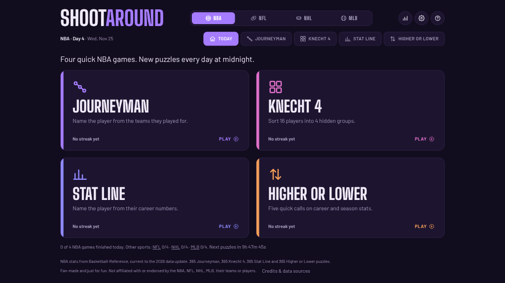
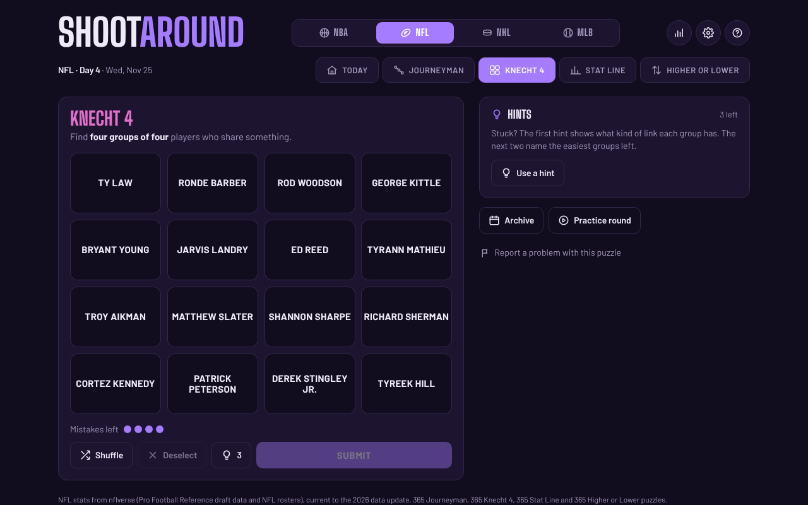
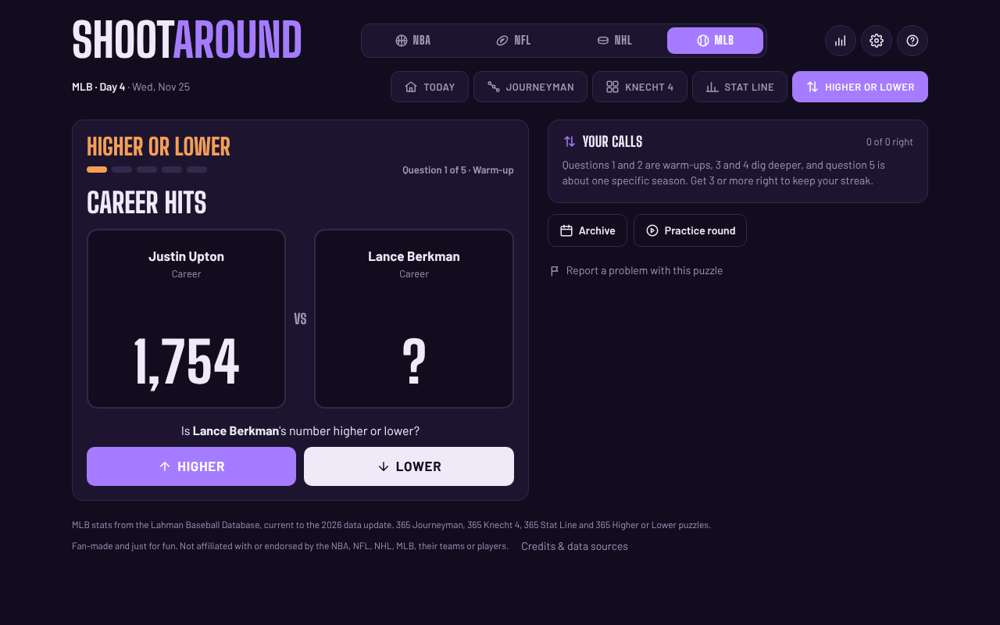
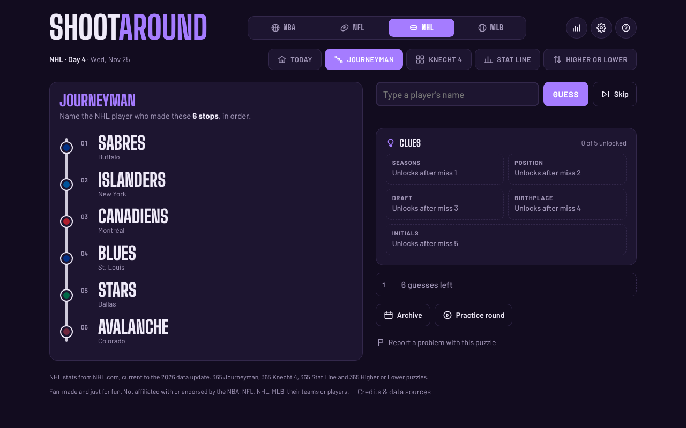
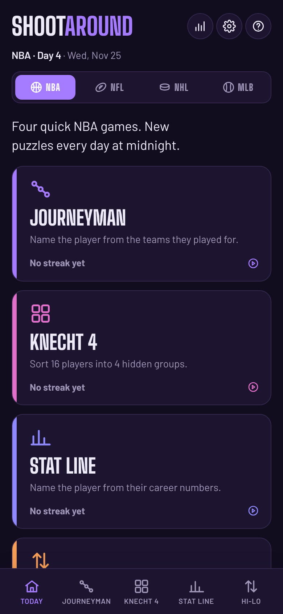

<p align="center"></p>

# Shootaround

**Four quick daily sports puzzles for NBA, NFL, NHL and MLB fans.** New puzzles every day at midnight, no sign-up, free to play in your browser.

### ▶️ [Play now: derek1267.github.io/Shootaround](https://derek1267.github.io/Shootaround/)

Works on phones, tablets and computers. No account, no ads, no downloads.

## The games

| Game | How it works |
|---|---|
| 🧭 **Journeyman** | See every team a player suited up for, in order. Name the player in 6 guesses. Each miss unlocks a clue (seasons, position, draft, college or birthplace, initials). Teams show their current name, with the old one noted ("Thunder · Seattle (SuperSonics)"). |
| 🟪 **Knecht 4** | Sort 16 players into 4 hidden groups of 4: teams, colleges, draft picks, awards, milestones, birthplaces, even first names. 4 mistakes allowed, 3 hints. Some players fit more than one group, but only one way uses all sixteen. |
| 📊 **Stat Line** | Name the player from their career numbers. Each guess shows that player's stats with ↑/↓ arrows pointing toward the answer. |
| ↕️ **Higher or Lower** | Five quick calls: is the second player's number higher or lower? Questions get harder as you go, and the last one is about a single season. |

Each sport has its own set of all four games and its own streaks. Switch sports with the tabs at the top.

## Screenshots

| Knecht 4 | Higher or Lower |
|---|---|
|  |  |
| **Journeyman** | **On your phone** |
|  |  |

## How to play in 30 seconds

1. Open the site and pick a sport at the top: NBA, NFL, NHL or MLB.
2. Tap a game. The rules pop up the first time, and you can reopen them any time with the **?** button.
3. Finish all four, then tap **Copy result** to send your score to friends. It's spoiler-free.
4. Come back tomorrow: new puzzles arrive at midnight your time.

## Features

- **Daily puzzles** with a streak for each game, and a shareable, spoiler-free result
- **Practice rounds** whenever you want more, which don't affect your stats
- **Archive** of every past day
- **Hints, clues and a Skip button** when you're stuck
- **Colour-blind friendly mode** (⚙ Settings) with shapes on Knecht 4 groups
- **Keyboard shortcuts:** Enter and Esc in Knecht 4; ↑/↓ (or H/L) and Enter in Higher or Lower
- **Works on phones and big screens:** a bottom tab bar on mobile, two columns on desktop

## FAQ

**When do new puzzles come out?** At midnight in your own time zone.

**Where are my stats saved?** Only in your browser, on this device. Clearing site data resets them, and they don't sync between devices.

**I found a wrong fact.** Use **Report a problem with this puzzle** at the bottom of any game. It opens a GitHub issue that already includes the puzzle details. Thanks!

**Is this official?** No. Shootaround is a fan-made project. It is not affiliated with or endorsed by the NBA, NFL, NHL, MLB, any team or any player, and it uses no team logos.

---

## For developers

Want to see how it works, or host your own copy? Everything below is optional, and players don't need any of it.

### Run your own copy

The site is plain HTML, CSS and JavaScript with JSON data files. There's no server or build step needed to play.

**Try it locally.** Run a small web server from this folder; opening `index.html` directly won't load the puzzles.

```bash
python3 -m http.server 8000
# open http://localhost:8000
```

**Host it on GitHub Pages:**
1. Fork this repo.
2. Go to **Settings → Pages** and set **Source** to your main branch, root folder.
3. In `index.html`, update the two settings near the top of the script, plus the `og:` links in the `<head>`, to your username and repo:
   ```js
   const GITHUB_REPO = "your-name/Shootaround";                  // where "Report a problem" opens issues
   const SITE_URL = "https://your-name.github.io/Shootaround/";  // link added to shared results
   ```
4. Make sure **Issues** are switched on (Settings → General → Features).

#### Files

| File | What it is |
|---|---|
| `index.html` | The whole site: layout, styles and game logic |
| `nba.json`, `nfl.json`, `nhl.json`, `mlb.json` | 365 days of Journeyman, Knecht 4 and Stat Line per sport, plus the player lists for guessing |
| `hl-nba.json`, `hl-nfl.json`, `hl-nhl.json`, `hl-mlb.json` | 365 days of Higher or Lower per sport (5 questions a day) |
| `og.png` | Preview image for shared links |
| `build/` | Scripts that generate and check the puzzle files |

### The puzzle schedule is fixed

Day 1 is **22 November 2026**. Each day's puzzles are stored in the JSON files, so everyone gets the same puzzle. **Don't regenerate the files once people are playing:** that would change every day's puzzle and reset everyone's progress for the day. The build scripts refuse to overwrite existing files unless you pass `--force`. After day 365 the puzzles loop back to day 1.

### Rebuilding the data

```bash
pip install -r build/requirements.txt
cd build
bash get_data.sh                     # downloads raw data into ../raw-data (~300 MB)
python3 build.py --force             # NBA: Journeyman, Knecht 4, Stat Line (~10 min)
python3 build_sport.py nfl nhl mlb --force
python3 hl_build.py nba nfl nhl mlb --force   # Higher or Lower
python3 verify.py && python3 verify_sport.py nfl nhl mlb && python3 verify_hl.py
```

The checkers make sure that:
- every Knecht 4 player really fits their group, and each grid has exactly one solution;
- no group repeats;
- Journeyman routes match the data;
- Higher or Lower values match the career and season numbers, with no ties.

### How the puzzles are made

Every puzzle is generated from real data rather than written by hand:
- Players are ranked by a fame score (All-Star or Pro Bowl picks, awards, career totals, Hall of Fame), weighted toward recent careers.
- Early-week puzzles use the best-known players, and later days dig deeper.
- Knecht 4 grids are built from categories like teams, colleges, draft picks, awards, milestones, birthplaces, heights and names. A solver then checks that only one grouping works, and rejects grids where an unintended fifth group sneaks in.

## Data sources and credits

- **NBA:** Basketball-Reference, via [bball-reference-datasets](https://github.com/sumitrodatta/bball-reference-datasets)
- **NFL:** [nflverse](https://github.com/nflverse/nflverse-data) (CC-BY-4.0), including Pro Football Reference draft data
- **NHL:** NHL.com, via [natashk/NHL](https://github.com/natashk/NHL)
- **MLB:** the [Lahman Baseball Database](https://sabr.org/lahman-database/) by Sean Lahman, via the [Lahman R package](https://github.com/cdalzell/Lahman)

Please keep these credits if you share or adapt the project, and check each source's terms before using the data for anything beyond a free fan project.

### Known limits

- NFL covers drafted players since 1980, so undrafted players (for example Kurt Warner or Tony Romo) aren't included.
- NHL covers skaters only (no goalies) and has no award-based groups.
- Active players' numbers are a snapshot from the last data build and don't update during the season.
- Title counts credit a player when they finished that season on the championship team.

## License

The code is released under the [MIT License](LICENSE). The sports statistics in the data files come from the sources listed above and remain under their original terms.
