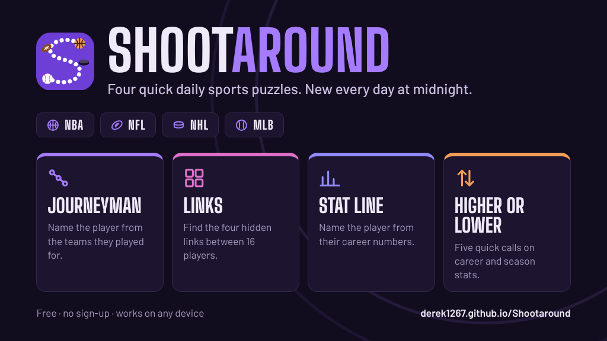

  

<h1 align="center">Shootaround</h1>

  <strong>Four quick daily sports puzzles. New ones every day at midnight.</strong> 
  NBA · NFL · NHL · MLB, free in your browser, no sign-up.

  <a href="https://derek1267.github.io/Shootaround/"><strong>▶ Try it: derek1267.github.io/Shootaround</strong></a>

---

## The games

- 🧭 **Journeyman:** see every team a player suited up for, in order, and name him in 6 guesses.
- 🟪 **Links:** sort 16 players into 4 hidden groups of 4.
- 📊 **Stat Line:** name the player from his career numbers.
- ↕️ **Higher or Lower:** five quick calls on who has the bigger number.

Each sport has its own set of all four games, its own streaks, an archive of past days and a spoiler-free result to share.

**Modern or All-time:** pick Modern for players from the 2010s and 2020s, or All-time to go back to 1980. Each era has its own daily puzzles and streaks.

## How it's built

The site is one static `index.html` (plain HTML, CSS and JavaScript) that reads a year of puzzles from JSON files, served with GitHub Pages. The puzzles are generated from real stats with Python scripts in [`build/`](build/), which also check every answer. See [build/README.md](build/README.md) to run or rebuild your own copy. Stats and streaks are saved only in your browser.

## Data

NBA from Basketball-Reference via [bball-reference-datasets](https://github.com/sumitrodatta/bball-reference-datasets), NFL from [nflverse](https://github.com/nflverse/nflverse-data) (CC-BY-4.0), NHL from NHL.com via [natashk/NHL](https://github.com/natashk/NHL), and MLB from the [Lahman Baseball Database](https://sabr.org/lahman-database/) via the [Lahman R package](https://github.com/cdalzell/Lahman).

Shootaround is a fan project and is not affiliated with the NBA, NFL, NHL, MLB, any team or any player.

## License

The code is under the [MIT License](LICENSE). The stats in the data files stay under their sources' terms.
